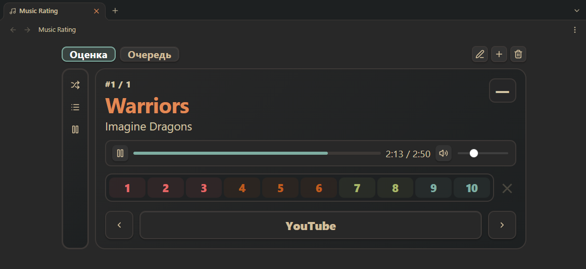
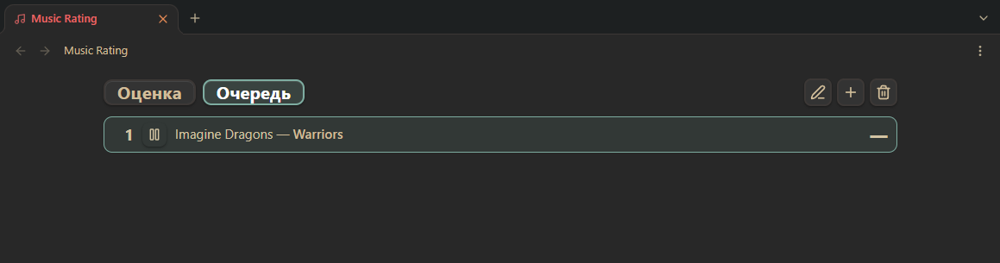

# Music Rating

Плагин Obsidian для оценки музыкальных треков, которые хранятся в вашем хранилище. Треки — это Markdown-заметки с аудиофайлами, привязанными через frontmatter. Плагин добавляет отдельную панель для прослушивания, оценки и просмотра треков.

## Возможности

- Отдельная панель с двумя вкладками: **Оценка** и **Очередь**.
- Оценка треков от 1 до 10.
- Воспроизведение прикреплённых аудиофайлов прямо в панели.
- Открытие YouTube-ссылок для треков.
- Кнопки: перемешивание очереди, фильтр по неоценённым трекам, автопереход.
- Автоматический переход к следующему треку, у которого есть аудиофайл.
- Создание, редактирование и удаление треков без выхода из панели.
- Автоматическое удаление заметки и папки исполнителя, когда удаляется последний трек.
- Интерфейс на английском и русском языках.
- Все свойства frontmatter, принадлежащие плагину, имеют префикс `music_rating_`, что исключает конфликты с другими плагинами.

### Вкладка **Оценка**



### Вкладка **Очередь**



## Установка

### Через BRAT

1. Установите и включите плагин BRAT в Obsidian.
2. `Ctrl+P` -> `BRAT: Add a beta plugin for testing`.
3. Введите https://github.com/LeeryLis/music-rating (или **LeeryLis/music-rating**).
4. Выберите версию, нажмите `Add Plugin`, дождитесь установки.
5. Включите Music Rating в списке сторонних плагинов.
Обновления: `Ctrl+P` -> `BRAT: Check for updates to all beta plugins and UPDATE`

### Вручную

1. Скачайте `main.js`, `manifest.json` и `styles.css` из последнего релиза.
2. Положите их в `<vault>/.obsidian/plugins/music-rating/`.
3. Перезапустите Obsidian и включите плагин в настройках.

Альтернативно - скачайте архив `music-rating.zip` из релиза и распакуйте в `<vault>/.obsidian/plugins/` (папка `music-rating` появится автоматически).

## Организация заметок

Плагин ожидает папку коллекции (настраивается, по умолчанию `Music`) со следующей структурой:
```
Music/
    Artists/
        Metallica.md
        Nirvana.md
    Tracks/
        Metallica/
            One.md
            Master of Puppets.md
        Nirvana/
            Smells Like Teen Spirit.md
    Audio/
        Metallica - One.mp3
        Nirvana - Smells Like Teen Spirit.mp3
    Artists.md
```

- `Artists/` — по одной заметке на исполнителя.
- `Tracks/<Исполнитель>/` — по одной заметке на трек.
- `Audio/` — аудиофайлы. Плагин умеет находить файл по шаблону `<Исполнитель> - <Название>`.
- `Artists.md` — заметка-индекс исполнителей. Создаётся автоматически при первом использовании. Имя настраивается в параметрах плагина.

### Заметка трека

```
---
music_rating_type: track
music_rating_artist: "[[Metallica]]"
music_rating_rating:
music_rating_local_file: "[[Metallica - One.mp3]]"
music_rating_youtube_link: https://www.youtube.com/watch?v=...
---
```

### Заметка исполнителя
```
---
music_rating_type: artist
music_rating_moc:
    - "[[Artists]]"
---
```

### Заметка-индекс исполнителей

```
---
music_rating_type: artists_index
---
```

## Использование

1. Откройте через иконку на Ribbon (левая панель в Obsidian) или выполните команду **Open Music Rating**.
2. Создайте первый трек кнопкой **+** или командой **Add track**. Укажите исполнителя и название, при необходимости — имя аудиофайла и ссылку на YouTube.
3. Кнопка **Синхронизация** рядом с полем аудиофайла автоматически ищет подходящий файл в указанной в настройках директории.
4. Оцените текущий трек, нажав на число от 1 до 10. Кнопка **✕** сбрасывает оценку.
5. Стрелки переключают треки. Вкладка **Очередь** позволяет перейти к любому треку списка.

## Настройки

| Настройка | Описание |
|---|---|
| Язык | Язык интерфейса: Автоматически (как в Obsidian), English или Русский. |
| Папка коллекции | Корневая папка коллекции. Внутри плагин создаёт `Artists/` и `Tracks/`. |
| Папка с аудиофайлами | Папка с аудиофайлами. Используется для автоподстановки ссылки на файл по шаблону `<Исполнитель> - <Название>`. |
| Заметка-индекс исполнителей | Имя заметки в корне коллекции со списком всех исполнителей. Создаётся автоматически. |
| Показывать уведомление при оценке | Показывать уведомление при каждом сохранении оценки. |
| Переключать трек после оценки | Автоматически переходить к следующему треку после выставления оценки. |

## Свойства frontmatter

Все свойства, принадлежащие плагину, имеют префикс, чтобы не пересекаться с другими плагинами:

| Свойство | Назначение |
|---|---|
| `music_rating_type` | Тип заметки: `track`, `artist` или `artists_index`. |
| `music_rating_artist` | Исполнитель в виде вики-ссылки. |
| `music_rating_rating` | Оценка от 1 до 10. Пусто, если трек не оценён. |
| `music_rating_local_file` | Аудиофайл в виде вики-ссылки. |
| `music_rating_youtube_link` | Ссылка на YouTube. |
| `music_rating_moc` | Ссылка Map of Content из заметки исполнителя на индекс исполнителей. |

## Разработка

Требования: Node.js 18+, npm

```
git clone https://github.com/LeeryLis/music-rating.git
cd music-rating
npm install
npm run dev    # watch-режим, собирает dist/music-rating/
npm run build  # production-сборка
```
Сборка складывается в `dist/music-rating/` - готовую папку можно скопировать в `<vault>/.obsidian/plugins/`

## Совместимость

- Obsidian: 1.5.0+
- Платформы: desktop

## Лицензия

MIT